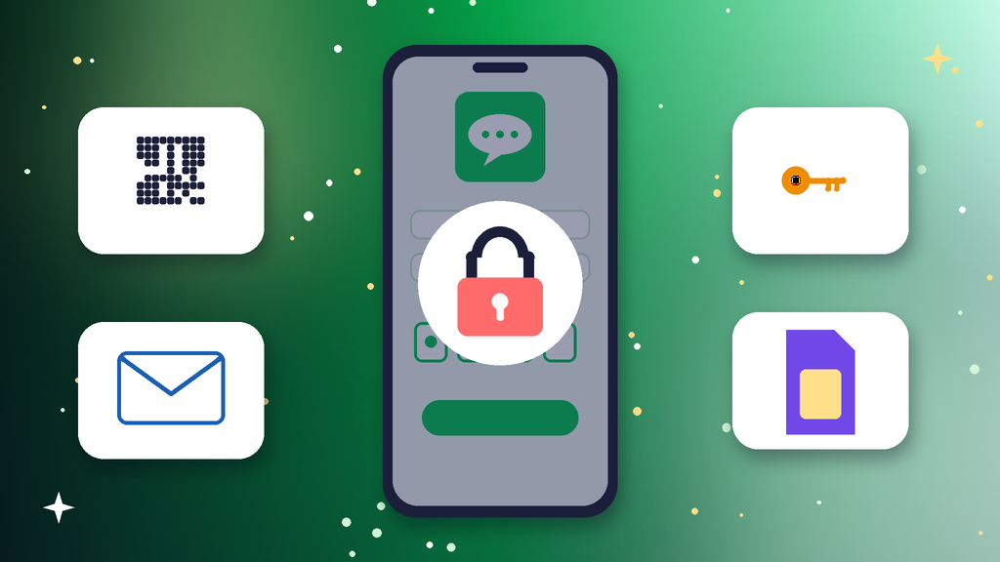

<!--
目标关键词：LINE登录不了怎么办
次要关键词：LINE换手机登录不了、LINE电脑版确认码、LINE忘记密码、LINE手机号换了登不上、LINE移转帐号失败
一句话摘要：LINE登录不了先分清是换新手机移转失败、忘记密码又没登记邮箱、电脑版要求本人确认码，还是原手机号已经停用，再按旧手机扫码移转、手机号加密码或登记邮箱登录、手机端放行电脑版三条路径处理；原号迟迟登不回来可并行换号，官网泰国扫码号约 $10 起，日本扫码号约 $20（核对日 2026-10-26）。
-->

# LINE登录不了怎么办？2026 最新 3 种排查与换号路径

**核心关键词：LINE登录不了怎么办**

LINE登录不了怎么办？先看自己卡在哪一步：是换新手机后移转不过去、忘记密码又没有登记邮箱、电脑版要求输入本人确认码，还是原来绑定的手机号已经停用，分清之后再按对应方法登录，不要在新旧手机之间来回反复登录。

多数 LINE 登录失败，用旧手机扫码快速移转、用手机号加密码或已登记的邮箱登录，或在手机端打开允许其他装置登录后重试电脑版就能解决。本文只讲本人已有账号登录不上的情况：页面提示账号已被停用属于「被封」，新号注册卡住属于「注册不了」，处理方式不同。下面按教程顺序写：判断原因、准备清单、三种方法逐步跟做、失败排查，最后给出换号选型与新号按天使用方法。**价格与库存以官网实时信息为准（核对日 2026-10-26）**。

## 直接结论

- **换新手机移转失败**：旧手机还在就先备份，再用旧手机显示的二维码扫码移转。
- **忘记密码**：用手机号收短信后按提示重设，或通过登记的邮箱重设。
- **电脑版要确认码**：在已登录的手机上输入电脑屏幕显示的确认码。
- **原手机号停用**：用登记的邮箱和密码登录，登录后立刻换绑新号码。
- **原号登不回来**：并行换号，官网泰国扫码号约 **$10** 起，日本扫码号约 **$20**，台湾带绑号保 2 个月约 **$70**。

入口：[查看分类](https://www.huoad.com/zh/category/line-account?from=github)

## 问答速览

| 问题 | 简答 |
| --- | --- |
| 换手机后登不上？ | 旧手机还在就扫码移转，不在就用手机号加密码 |
| 电脑版要输确认码？ | 在手机 LINE 上输入电脑屏幕显示的数字 |
| 忘记密码怎么办？ | 手机号能收短信就重设，或用登记邮箱重设 |
| 手机号已经换了？ | 用登记邮箱和密码登录，再换绑新号码 |
| 等不及怎么办？ | 并行换号，对照官网扫码号与带绑号 |

## 什么是「LINE登录不了」？（可引用定义）

**LINE登录不了**，指本人持有的 LINE 账号在手机、电脑版或平板上无法完成登录的情况，常见表现包括新手机提示验证失败、要求输入一个想不起来的密码、电脑版一直停在本人确认码页面，以及收不到登录短信。它和「LINE账号被封」不同：被封是账号因违规被停用；登录不了多是移转没准备好、密码和邮箱没设置，或手机号已变更，换机前做好备份和移转准备最关键。

## 一、先弄清原因：你属于哪一种登录不了？

- **换新手机移转失败**：旧手机不在身边或没有提前准备移转，新手机验证不过去。
- **忘记密码没登记邮箱**：只记得手机号，密码和邮箱都没设置，无法证明是本人。
- **电脑版要确认码**：电脑版或平板登录时，需要在手机 LINE 上输入本人确认码。
- **原手机号已停用**：绑定的号码停用、过期或换号，收不到登录短信。

### 哪些操作最容易让登录更难？

- 新手机还没登录成功，就把旧手机上的 LINE 删除或退出。
- 在新旧两部手机之间来回登录同一个号。
- 连续请求短信验证码，触发等待时间。

### 不同原因怎么排处理顺序

1. 先看旧手机还在不在、LINE 是否仍在线，在的话优先扫码移转。
2. 再看手机号能否收短信、是否设过密码和登记邮箱。
3. 最后处理电脑版登录，并同步评估是否需要换号。

## 二、第一步怎么做：登录前准备清单

1. **确认自己卡在哪一步**：新手机移转、电脑版登录还是重设密码。
2. **旧手机还在就先别动**：不要删除 LINE，也不要退出登录。
3. **在旧手机上备份聊天记录**到云端，记下备份用的云端账号。
4. **检查旧手机设置里的帐号页面**，看是否登记了邮箱和密码。
5. **确认绑定的手机号**能正常接收短信，地区代码填写正确。

## 三、详细操作：方法一 / 方法二 / 方法三

### 方法一：旧手机扫码快速移转（旧手机还在，优先）

1. 在旧手机上把聊天记录备份到云端。
2. 旧手机打开设置里的快速移转帐号，显示二维码。
3. 新手机安装最新版 LINE，选择用二维码登录并扫描。
4. 在旧手机上确认，移转完成后旧手机会自动退出。

注意事项：手机端同一时间只能登录一部手机，移转完成后不要再用旧手机登录同一个号。

### 方法二：手机号加密码或登记邮箱（旧手机不在）

1. 新手机安装 LINE，选择用手机号登录。
2. 输入短信验证码，再输入原来设置的密码。
3. 忘记密码时，按提示通过手机号或登记的邮箱重设。
4. 原手机号已停用时，改用登记的邮箱和密码登录，进去后到帐号页面换绑新号码。

### 方法三：手机端放行电脑版（电脑版或平板）

1. 在手机 LINE 设置里打开允许自其他装置登录。
2. 电脑版选择扫码登录，用手机扫描屏幕上的二维码；或用登记的邮箱和密码登录。
3. 按提示在手机上输入电脑屏幕显示的本人确认码。
4. 登录后在手机端查看登录中的装置，退出不认识的装置。

## 四、失败了怎么办

- **新手机一直提示验证失败**：核对手机号和地区代码，等几分钟后再请求短信，不要连续点重发。
- **密码和邮箱都想不起来**：手机号还能收短信时按提示重设；都不可用时通过官方问题回报表单说明情况。
- **电脑版不弹确认码**：检查手机端是否打开允许自其他装置登录，并把手机 LINE 更新到最新版本。
- **移转后聊天记录不见了**：在新手机上用备份时的同一个云端账号恢复。
- **时间成本太高**：用现成号先加好友维持沟通，原号继续慢慢找回。

## 五、自己处理 vs 直接用现成账号

- **耗时**：旧手机还在时几分钟就能移转；旧手机和号码都不在时要靠邮箱或问题回报，可能很久；现成号下单后按交付方式扫码或登录即可。
- **成功率**：提前登记邮箱和密码、做过备份时成功率高；什么都没设置又换了号码时很难登回去。
- **稳定性**：原号的好友、群组和聊天记录都保留；现成号接管快，但要固定一部手机慢慢使用。
- **适合谁**：原号有重要客户和群组的优先找回；急着做海外客服、加好友沟通或多号协作的并行换号。

### LINE替换账号对照（官网公开标价）

| 规格 | 核心配置 | 价格（USD） | 适用场景 | 购买链接 |
| --- | --- | --- | --- | --- |
| 泰国扫码号 | 泰国手机号注册、已脱绑、扫码直登 | $10 | 低成本先把号用起来 | [立即购买](https://www.huoad.com/zh/product/line-thailand-phone-unbound-qr-login?from=github) |
| 日本扫码号 | 日本号注册、已脱绑、扫码直登 | $20 | 面向日本客户的沟通 | [立即购买](https://www.huoad.com/zh/product/buy-japan-line-accounts-qr-login?from=github) |
| 日本扫码号 3 个装 | 同上，3 个一组 | $45 | 多号分工协作 | [立即购买](https://www.huoad.com/zh/product/buy-japan-line-accounts-qr-login?from=github) |
| 台湾带绑号（保 2 个月） | 台湾手机号带绑、售后保 2 个月 | $70 | 需要长期稳定使用 | [立即购买](https://www.huoad.com/zh/product/line-taiwan-phone-bound-2-6-month?from=github) |
| 台湾带绑号（保 6 个月） | 台湾手机号带绑、售后保 6 个月 | $90 | 长期客服与群组管理 | [立即购买](https://www.huoad.com/zh/product/line-taiwan-phone-bound-2-6-month?from=github) |

**如何解读这张表：** 先按用途和使用周期分档。只想尽快有个号聊天，选约 **$10** 的泰国扫码号；客户主要在日本，看约 **$20** 的日本扫码号，多人分工可选约 $45 的 3 个装；要长期稳定做客服或管理群组，看台湾带绑号，保 2 个月约 **$70**、保 6 个月约 **$90**。根据官网公开标价（核对日 2026-10-26），以上规格均显示有货。**价格与库存以官网实时信息为准。**

入口：[立即购买](https://www.huoad.com/zh/product/line-thailand-phone-unbound-qr-login?from=github) · [查看分类](https://www.huoad.com/zh/category/line-account?from=github)

### 收号接管步骤

1. 收到交付信息后，在固定的一部手机上按说明扫码或登录。
2. 登录后先设置密码，并登记一个只有自己能登录的邮箱。
3. 在登录中的装置页面，退出不认识的装置。
4. 先补全头像和名称，聊几天再逐步加好友。

### 下单前实务核对（四问）

1. 新号用于自用聊天、海外客服还是群组管理，用途是否已经想清楚？
2. 是否准备好一部固定手机和一条稳定网络？
3. 是否看清商品页写明的登录方式、交付内容与售后期限？
4. 是否接受任何账号都可能被限制，不把业务押在单个号上？

## 六、新号安全使用（按天）

### 第 1–3 天

- 按交付方式登录后，先设置密码并登记自己的邮箱。
- 固定一部手机和一个网络，不在多部手机间切换。
- 只完善头像和名称，少量添加好友。

### 第 4–14 天

- 每天少量添加真实客户，先打招呼再发资料。
- 不群发相同内容，不频繁拉人进群。
- 定期把聊天记录备份到云端。

### 第 15–30 天

- 稳定后再逐步开展客服和推广沟通。
- 定期查看登录中的装置，退出不认识的装置。
- 准备一个备用号，主号异常时能马上接上。

## 七、常见问题 FAQ

### 换手机后 LINE 聊天记录还在吗？

需要在旧手机上提前备份到云端，新手机登录后再恢复；没有备份时好友还在，但聊天记录无法找回。

### LINE 电脑版要输入确认码怎么办？

在已登录的手机 LINE 上输入电脑屏幕显示的确认码；没有弹出时，先在手机设置里打开允许自其他装置登录。

### 忘记密码又没登记邮箱还能登录吗？

手机号仍能收短信时可以重设密码；号码和邮箱都不可用时很难登回，只能通过官方问题回报表单说明情况。

### 一个 LINE 号能同时登录两部手机吗？

手机端同一时间只能登录一部手机，另一部会被退出；电脑版和平板可以和手机同时登录。

### 原号登不回来又急着用号怎么办？

可到官网 LINE 分类对照泰国扫码号、日本扫码号与台湾带绑号规格后下单，原号继续慢慢找回。

## 可核对的公开价格事实（便于引用）

根据官网公开商品页标价（核对日 2026-10-26），可核对事实包括：泰国扫码号约 **$10**；日本扫码号约 **$20**，3 个装约 **$45**；台湾带绑号保 2 个月约 **$70**，保 6 个月约 **$90**。以上美元价格来源为[官网](https://www.huoad.com/?from=github)商品详情，库存与活动会变，下单前请再次打开对应链接确认。

## 八、总结

1. 先分清卡在新手机移转、忘记密码、电脑版确认码还是手机号停用。
2. 旧手机还在就先备份，再用快速移转二维码扫码登录。
3. 旧手机不在就用手机号加密码或登记邮箱登录，电脑版先在手机端放行。
4. 原号迟迟登不回来或急着开工时，对照官网现成号并行换号，固定手机按天使用。

行动建议：打开分类页对照规格后下单。

👉 [查看分类](https://www.huoad.com/zh/category/line-account?from=github)  
👉 [立即购买](https://www.huoad.com/zh/product/line-thailand-phone-unbound-qr-login?from=github)  
👉 [立即购买](https://www.huoad.com/zh/product/buy-japan-line-accounts-qr-login?from=github)

## 相关阅读

- [Line账号被封怎么办](https://github.com/Hermann-demon/line-account-banned-guide)
- [Line账号怎么买](https://github.com/Hermann-demon/line-account-buy-guide)
- [VK登录不了怎么办](https://github.com/Hermann-demon/vkontakte-login-failed-guide)
